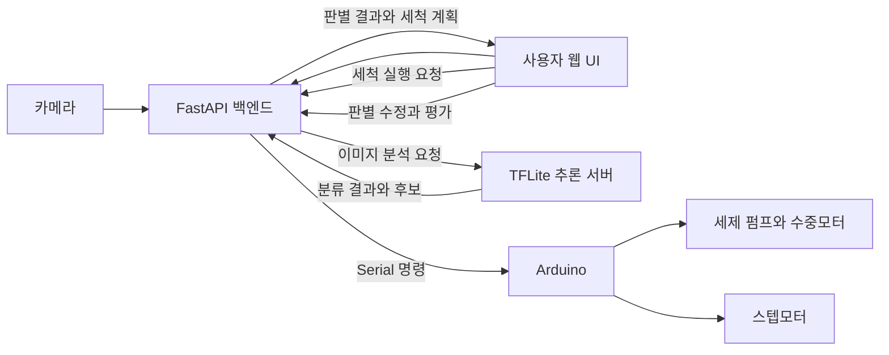

# 스마트 자동 세척기 (Capstone 2026)

얼룩 이미지를 분류하고(모델 추론), 원단/색상 맥락을 함께 반영해 세제 및 세척 동작을 추천/실행하는 프로젝트입니다.  
웹 UI + FastAPI 백엔드 + TFLite 추론 서버 구조로 구성되어 있습니다.

## 담당 역할

팀 프로젝트에서 **팀장과 백엔드·피드백 기능 개발**을 담당했습니다.

- **백엔드**에서 이미지 분석 요청을 처리하고, 판별 결과를 세척 계획 및 실행 API와 연결했습니다.
- **피드백 기능**에서 사용자의 판별 평가와 실제 라벨을 받아 저장하는 흐름을 구현했습니다.

아래 시스템 구성과 기능 설명은 팀 프로젝트 전체의 구현 내용입니다.

## 시스템 구성과 제어 흐름



사용자는 촬영한 이미지의 판별 결과를 확인하고 세척을 요청합니다. 백엔드는 추론 결과와 원단 정보를 바탕으로 세척 계획을 산출하며, Arduino에 줄바꿈으로 구분한 Serial 명령을 전송합니다. Arduino 코드는 명령을 받아 펌프와 모터의 출력 및 동작 시간을 제어합니다.

### 코드에서 확인할 부분

| 구현 | 파일 | 확인할 내용 |
| --- | --- | --- |
| 분류 모델 호출과 결과 보정 | `stain_backend_app.py` | 추론 서버 응답과 원단·색상 조건을 최종 판정에 반영하는 흐름 |
| 이미지 전처리와 추론 | `tflite_server.py` | 224×224 크기 변환, RGB 변환, 정규화, TFLite 호출 |
| 사용자 판별 피드백 | `stain_backend_app.py`, `stain_fused_feedback_app.html` | 판별 수정과 피드백 저장 |
| 장치 명령 전달 | `stain_backend_app.py` | Serial 연결과 명령 전송, `/api/execute` 처리 |
| 펌프·모터 제어 | `stain_cleaner_controller.ino` | 명령 해석, 펌프 출력, 스텝모터 STEP/DIR 제어 |

이미지 기반 제거율은 세척 전후 영상 비교로 산출한 지표입니다. 분류 평가 자료와 실제 장치 동작은 아래 평가 파일 및 시연 영상에서 확인할 수 있습니다.

## 1. 핵심 기능

- 얼룩 분류: MobileNet 기반 CNN(TFLite)으로 오염원 분류
- 보정 로직: 색상군(빨강/갈색/노랑/흰색 계열), 원단 맥락(데님/어두운 배경) 반영
- 세척 계획: 오염원/원단 기반 세제 종류, 펌프 시간, 브러시 강도/횟수 산출
- 세척 후 평가: 1차/2차/세척완료 사진 비교 기반 제거율 피드백
- 피드백 수집: 예측 정오답/실제 라벨을 저장해 판정 보정 및 추후 재학습 데이터로 활용

## 2. 기술 스택

- Backend API: `FastAPI`
- Inference: `TensorFlow Lite` (`.tflite`)
- CV/OCR: `OpenCV`, `pytesseract`
- Frontend: 단일 HTML UI (`stain_fused_feedback_app.html`, `stain_fused_feedback_dev.html`)
- Hardware (옵션): `pyserial`, `RPi.GPIO`

## 3. 저장소 파일 구성

- `stain_backend_app.py`: 메인 API 서버, 분석/보정/세척 제어 로직
- `tflite_server.py`: TFLite 추론 API 서버 (`/predict`)
- `stain_fused_feedback_app.html`: 메인 사용자 UI
- `stain_fused_feedback_dev.html`: 개발자 UI
- `stain_classifier_v3.tflite`: 학습된 분류 모델
- `class_names.txt`: 클래스 이름 매핑
- `mobilenet_v1.py`: 모델 관련 코드(학습/구조 참고용)
- `stain_cleaner_controller.ino`: Arduino의 Serial 명령 처리, 스텝모터·펌프·수중모터 제어
- `accuracy_test_results.pdf`: 분류 평가 자료
- `docs/capstone_panel.pdf`: 프로젝트 판넬

## 4. 데이터셋/모델 개요

- 모델: MobileNet 기반 CNN
- 클래스: 오염원 12종(예: 커피, 케찹, 고추장, 카레, 머스타드, 기름 등)
- 수집: 클래스당 약 1000장 수준으로 촬영(빛/각도 다양화)
- 증강: Roboflow 기반 증강 데이터 포함
- 총 데이터: 약 36,000장
- 배포: 라즈베리파이 환경 추론을 위해 TFLite 변환 후 사용

## 5. 판정 보정 및 세척 강도

- 배경 보정: 흰색/회색/검정 배경과 연청/중청/진청 데님에서 촬영 밝기와 색상 왜곡이 달라질 수 있어, 중앙 얼룩 주변부의 배경 신호와 원단 정보를 함께 참고
- 색상 보정: 어두운 배경에서 빨강이 갈색으로 보이거나, 밝기 변화로 노랑이 흰색 계열처럼 보이는 경우를 줄이기 위해 색상군 후보를 재검토
- 후보 재판정: CNN의 상위 후보와 색상군(빨강/갈색/노랑/흰색 계열), 세제 계열, 1차/2차 이미지 변화량을 함께 비교해 최종 오염원을 결정
- 세척 강도 결정: 오염원별 세제 종류와 원단 그룹(면/데님, 합성, 민감 원단, 니트)에 따라 펌프 시간, 브러시 강도, 브러시 횟수를 다르게 적용
- 세척 후 평가: 세척 전후 이미지의 중앙 얼룩 영역 변화를 비교해 제거율을 계산하고, 추가 세척 여부를 안내

### 판정 및 피드백 흐름

1. CNN 모델이 1차로 오염원을 분류합니다.
2. CNN 신뢰도, TOP 3 후보, 색상군, 배경/원단 정보를 확인합니다.
3. 오류가 자주 발생하는 조건이면 API 보정 로직이 재판정합니다.
4. 재판정 결과를 포함한 최종 결과를 사용자에게 보여줍니다.
5. 사용자가 최종 결과에 대해 맞음/틀림 평가를 남깁니다.
6. 피드백은 이후 비슷한 상황의 보정 근거와 추후 모델 재학습 데이터로 활용합니다.

## 6. 빠른 실행 방법

### 6-1. Python 환경 준비

```powershell
python -m venv .venv
.venv\Scripts\activate
pip install --upgrade pip
pip install fastapi uvicorn numpy opencv-python requests pydantic pytesseract pyserial openai tensorflow
```

`RPi.GPIO`는 라즈베리파이에서만 설치/사용합니다.

### 6-2. 모델 파일 위치 확인

`tflite_server.py`는 기본적으로 아래 경로를 읽습니다.

- `models/stain_classifier_v3.tflite`
- `models/class_names.txt`

저장소의 모델과 클래스 파일은 루트에 있습니다. 실행 전에 아래 PowerShell 명령으로 `models/`에 복사합니다. 원본 파일은 그대로 유지합니다.

```powershell
New-Item -ItemType Directory -Force models | Out-Null
Copy-Item stain_classifier_v3.tflite models/
Copy-Item class_names.txt models/
```

### 6-3. 서버 실행

터미널 1 (추론 서버):

```bash
uvicorn tflite_server:app --host 0.0.0.0 --port 9000
```

터미널 2 (메인 서버):

```bash
uvicorn stain_backend_app:app --host 0.0.0.0 --port 8000
```

### 6-4. 접속

- 메인 UI: `http://<장비IP>:8000/`
- 개발자 UI: `http://<장비IP>:8000/developer`
- 상태 확인:
  - `http://<장비IP>:8000/api/health`
  - `http://<장비IP>:9000/health`

## 7. 주요 API

- `POST /api/analyze-triplet`: 1차/2차 이미지 분석, 최종 오염원/세제/근거 산출
- `POST /api/execute`: 세척 동작 실행(펌프/브러시)
- `POST /api/cleanup-feedback`: 세척 완료 후 제거율 분석
- `GET /api/video_feed`: 카메라 스트리밍
- `GET /api/capture`: 프레임 캡처
- `POST /api/learning-feedback`: 사용자 피드백 데이터 저장

## 8. 환경 변수 (자주 쓰는 항목)

- `TFLITE_SERVER_URL` (기본: `http://127.0.0.1:9000`)
- `CAMERA_INDEX`
- `OPENAI_API_KEY`, `OPENAI_MODEL`
- `ARDUINO_PORT`, `ARDUINO_BAUD`
- `FEEDBACK_ADJUST_ENABLED`

## 9. 시연 영상

- [시연 영상 1](https://www.youtube.com/watch?v=ilmVzH4CYjw)
- [시연 영상 2](https://www.youtube.com/watch?v=g3_SdDI3nyY)
